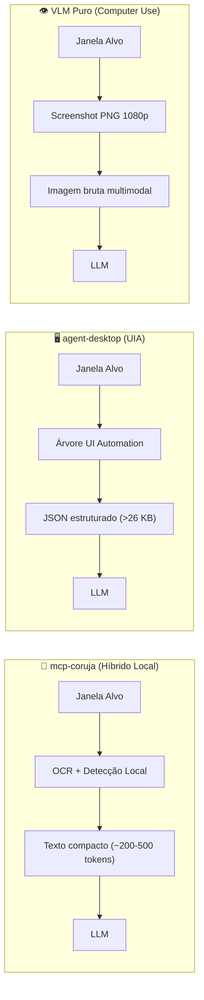
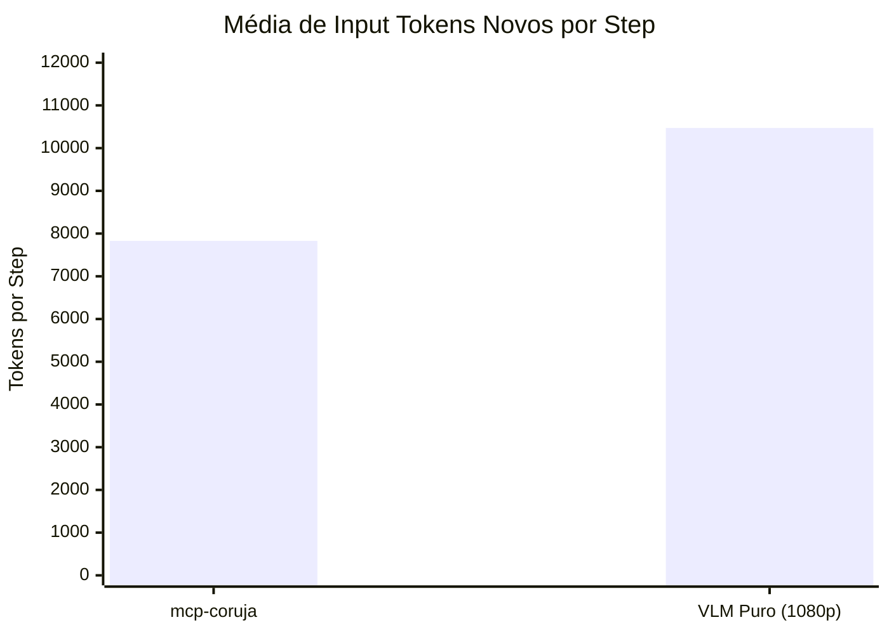
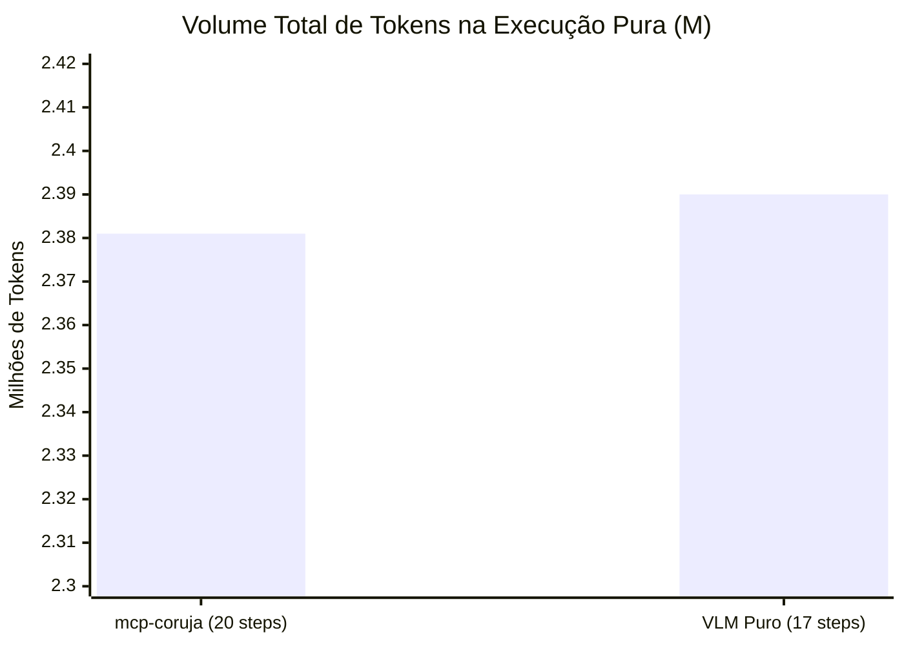
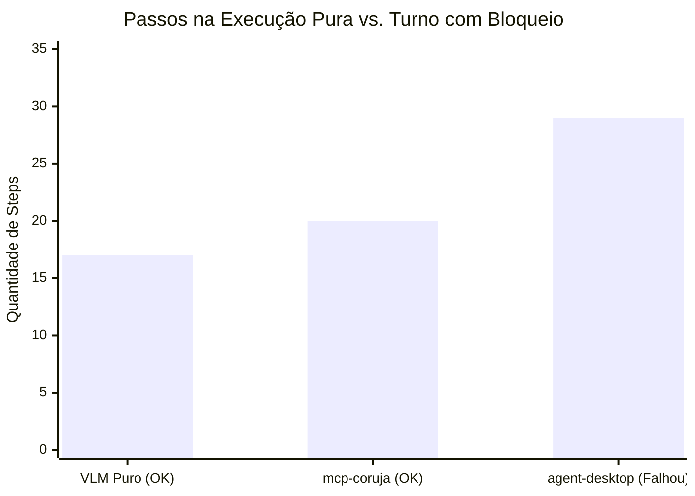

# 🦉 Benchmark: `mcp-coruja` vs UI Automation (`agent-desktop`) vs VLM Puro (Screenshots)

Este documento apresenta os resultados de um benchmark prático e controlado comparando três abordagens distintas para automação de interface gráfica (GUI) por agentes de IA no Windows:

1. **`mcp-coruja`** — Visão e OCR local híbrido + controle direto Win32.
2. **`agent-desktop`** — Árvore de acessibilidade nativa do sistema operacional (*Windows UI Automation*).
3. **VLM Puro (*Computer Use* tradicional)** — Capturas de tela Full HD (1920×1080) enviadas diretamente ao modelo multimodal.

---

## 🎯 Cenário do Benchmark Controlado

Para garantir comparação justa, todas as rodadas partiram do **mesmo estado inicial** (Google Chrome fechado) e executaram exatamente a mesma tarefa:

1. Iniciar o Google Chrome do zero.
2. Navegar até `https://pt.wikipedia.org`.
3. Localizar a barra de pesquisa e buscar por `"Inteligência Artificial"`.
4. Aguardar o carregamento do artigo e extrair o **título** e as **duas primeiras frases** da introdução.
5. Encerrar o processo do navegador.

---

## 🏗️ Diferença Arquitetural

---

## 📊 Resultados Consolidados (Execução Pura da Tarefa)

Ao isolar estritamente a execução da tarefa (da abertura do Chrome até o fechamento, desconsiderando passos iniciais de descoberta de caminho do executável no Windows):

### Execução da tarefa

| Métrica | 🦉 `mcp-coruja` | 🖥️ `agent-desktop` (UIA) | 👁️ VLM Puro (Screenshots) |
| :--- | :---: | :---: | :---: |
| **Status da Tarefa** | ✅ **100% Concluída** | ❌ **Bloqueada no conteúdo Web** | ✅ **100% Concluída** |
| **Passos na Execução Pura** | 20 steps | 29 steps *(turno completo)* | **17 steps** |
| **Payload por Inspeção** | ~200–500 tokens (texto) | **26.032 bytes** (1 snapshot JSON) | Imagem PNG 1920×1032 |

### Consumo de tokens

Os dois números andam juntos: **tokens novos** é o que entra de fato a cada chamada; **tokens totais** incluem tudo o que ficou no histórico, inclusive o que foi lido de cache.

| Métrica | 🦉 `mcp-coruja` | 🖥️ `agent-desktop` (UIA) | 👁️ VLM Puro (Screenshots) |
| :--- | :---: | :---: | :---: |
| **Tokens novos / step (média)** | **7.829** | 4.119 *(com falhas)* | 10.473 |
| **Tokens novos no turno** | **≈ 157 mil** | ≈ 119 mil | 178 mil |
| **Tokens totais no turno (inclui cache)** | **2.381.247** | 3.784.807 *(turno completo)* | 2.390.493 |
| **Tokens de output / step (média)** | **121** | 176 | 186 |

> [!NOTE]
> Mesmo executando **3 passos a menos** (17 vs 20), o **VLM Puro consumiu mais tokens** — tanto novos no turno (≈178 mil vs ≈157 mil) quanto totais (2.390.493 vs 2.381.247) — devido ao peso multimodal das capturas de tela em Full HD acumuladas no histórico.

### O que compõe os "tokens novos por step"

O valor da tabela é do **turno inteiro**, não da ferramenta. Medindo o lado do `mcp-coruja` com
`python tools/bench.py "<janela>"` (mesma máquina, mediana de 3 execuções):

| Componente | Ordem de grandeza |
| :--- | ---: |
| Definições das 20 ferramentas (schema enviado a cada request) | ≈ **1.900 tokens** |
| Resposta de uma ferramenta | **50–650 tokens** (`observe` completo ≈650, `diff` ≈70, `read_region` ≈90) |
| Raciocínio e mensagens do agente | o restante (≈5.000+) |

Latência por chamada (não coberta pelo teste de tokens): `observe` ≈480 ms, `read_region` ≈220 ms,
`detect_open` ≈400 ms, `look` ≈35 ms com DirectML.

Isso deixa claro o que o `mcp-coruja` controla: a resposta da ferramenta é uma fração pequena do
total por passo. O que muda em fluxos longos é o que fica no histórico — texto compacto por passo
contra uma imagem Full HD por passo.

---

## 📈 Gráficos Comparativos

### 1. Consumo Médio de Input Tokens Novos por Step

### 2. Total de Tokens na Execução Pura da Tarefa (Milhões)

### 3. Passos Necessários vs. Taxa de Sucesso

---

## 🔍 Análise Técnica por Abordagem

### 1. 🦉 `mcp-coruja` (OCR + Visão Local)
- **Pontos Fortes:**
  - **Independência de UIA/DOM:** Funciona de maneira uniforme em navegadores, apps Electron/Chromium (como Steam) e jogos DirectX/Vulkan.
  - **Contexto Enxuto:** `observe` e `read_region` processam a imagem localmente e enviam apenas texto e coordenadas (`e1 text "Wikipedia" 480,104`), evitando poluir o histórico com imagens pesadas.
  - **Escalabilidade:** Em um teste anterior de longa duração na **Steam** (identificação de 17 jogos instalados, leitura de tempo de jogo de cada um e desinstalação de 4 títulos), o `mcp-coruja` completou **155 chamadas** mantendo **~93% do contexto em cache** (10.254.029 tokens via *Cache Read* contra 758.763 tokens novos processados).
- **Trade-off:** Pode exigir alguns cliques ou leituras regionais adicionais (`read_region`) quando uma interface tem muitos elementos densos.

### 2. 🖥️ `agent-desktop` (UI Automation)
- **Pontos Fortes:** Excelente para aplicativos nativos tradicionais do Windows (Explorer, diálogos do sistema, formulários Win32/WPF) que implementam corretamente os padrões `InvokePattern` e `ValuePattern`.
- **Gargalos Identificados no Teste:**
  - **Bloqueio em Conteúdo Web:** Elementos internos de páginas no Chrome não expõem ação semântica de clique direto via UIA e, em modo *headless* padrão, a política bloqueia *fallback* físico de mouse (`POLICY_DENIED: direct semantic delivery is unavailable and physical fallback is denied`). Para automação web, requer inicialização dedicada via CDP (*Chrome DevTools Protocol*).
  - **Verbosidade da Árvore:** Um único `desktop_snapshot` na janela do Chrome gerou **26.032 bytes** de JSON, exigindo *offload* para arquivo externo para não saturar a janela de contexto.

### 3. 👁️ VLM Puro (Screenshots 1080p)
- **Pontos Fortes:** Menor atrito em fluxos curtos (3 passos a menos na tarefa da Wikipédia), pois o modelo enxerga a tela inteira de uma só vez sem depender de acessibilidade ou etapas de OCR.
- **Gargalos Identificados:**
  - **Custo por Passo (+33,8% maior):** A média de novos tokens de entrada por step foi de **10.473** contra **7.829** no `mcp-coruja`.
  - **Efeito Bola de Neve em Tarefas Longas:** Como cada captura 1920×1032 permanece no histórico multimodal, fluxos extensos (dezenas ou centenas de ações em jogos ou sistemas complexos) acumulam dezenas de imagens na janela de contexto, elevando latência e custo rapidamente.

---

## 🏆 Conclusão

| Cenário de Uso | Melhor Abordagem |
| :--- | :--- |
| **Jogos, apps customizados (Steam, Electron) e controle universal de desktop** | 🦉 **`mcp-coruja`** |
| **Apps nativos simples do Windows com acessibilidade completa** | 🖥️ **`agent-desktop`** |
| **Automação Web dedicada (sem precisar simular mouse/visão no SO)** | 🌐 **CDP / Playwright** |
| **Tarefas visuais muito curtas (2–5 cliques) sem suporte a OCR/UIA** | 👁️ **VLM Puro** |
