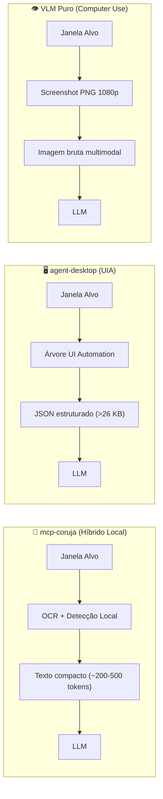
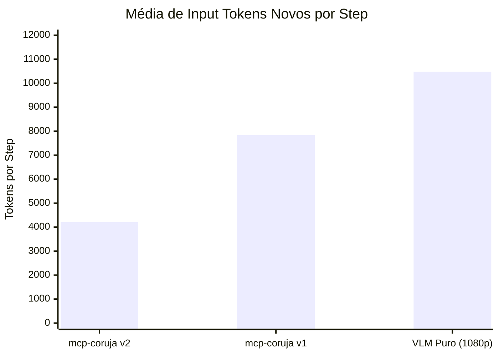
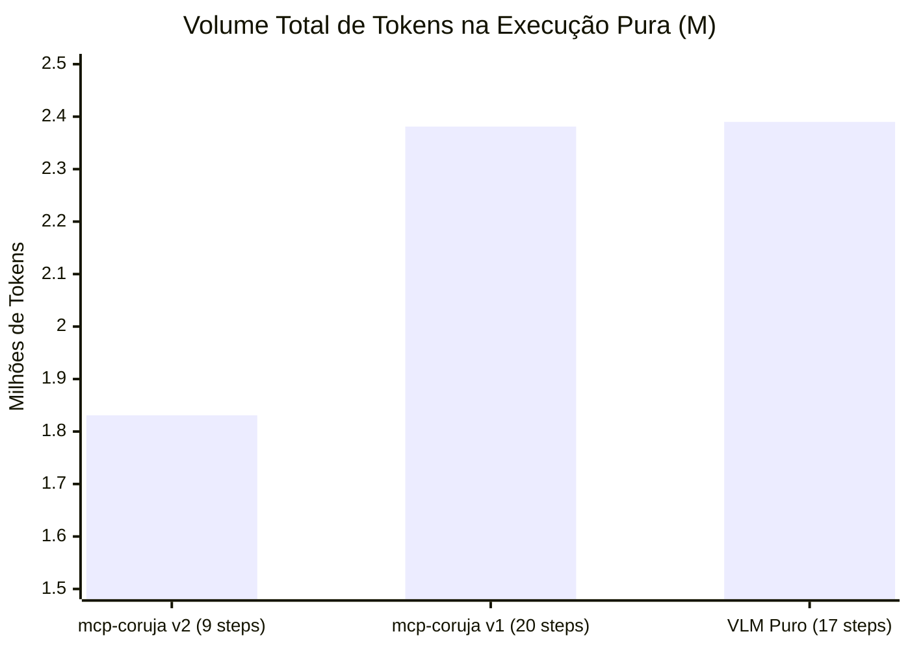
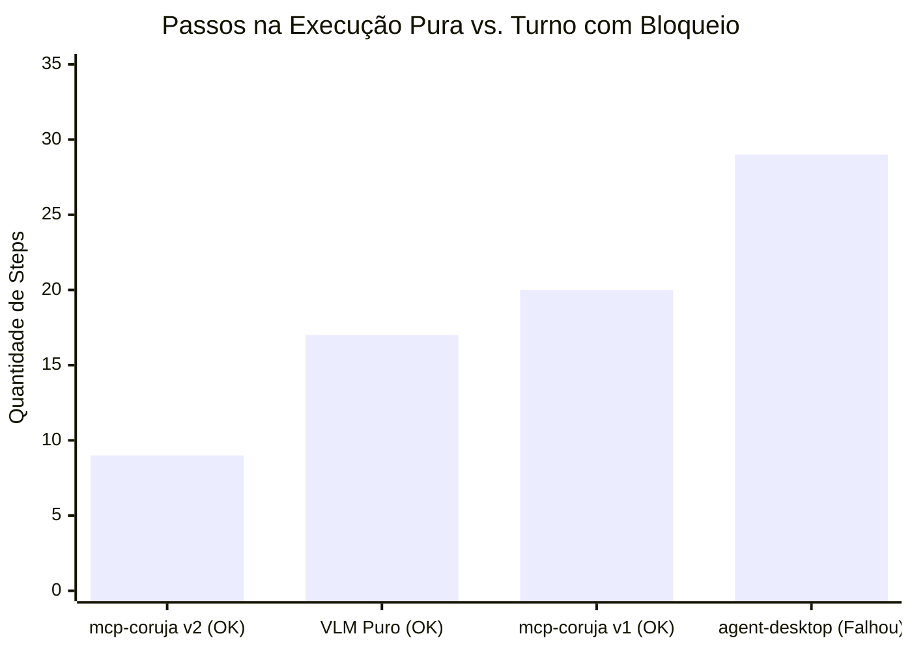
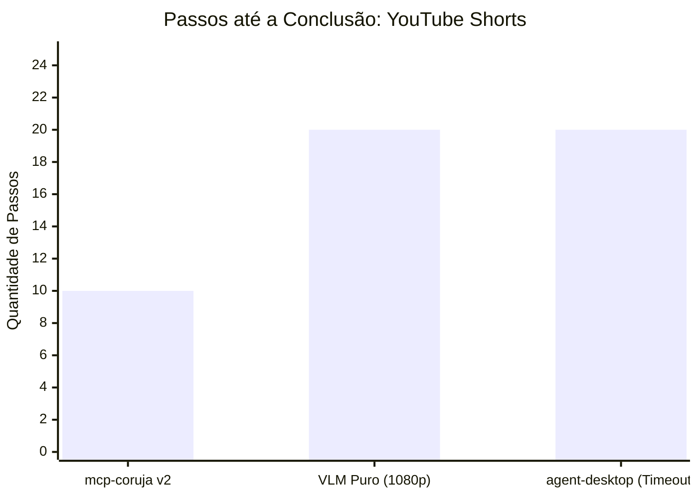
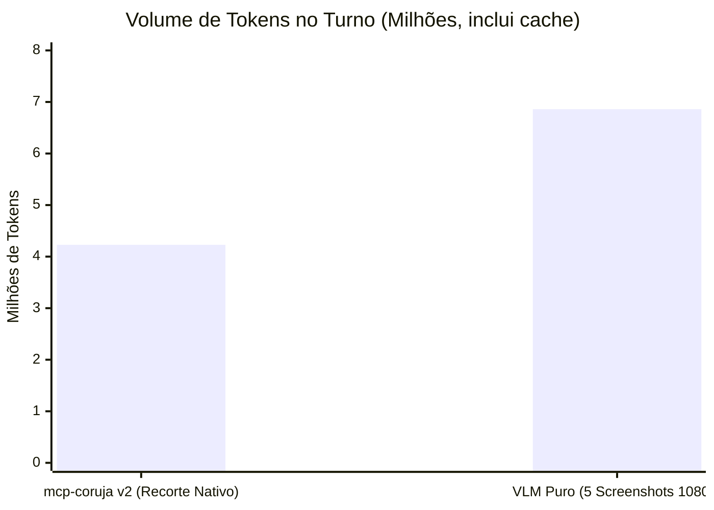

# 🦉 Benchmark: `mcp-coruja` vs UI Automation (`agent-desktop`) vs VLM Puro (Screenshots)

Este documento apresenta os resultados de um benchmark prático e controlado comparando três abordagens distintas para automação de interface gráfica (GUI) por agentes de IA no Windows:

1. **`mcp-coruja`** — Visão e OCR local híbrido + controle direto Win32.
2. **`agent-desktop`** — Árvore de acessibilidade nativa do sistema operacional (*Windows UI Automation*).
3. **VLM Puro (*Computer Use* tradicional)** — Capturas de tela Full HD (1920×1080) enviadas diretamente ao modelo multimodal.

---

## 📖 Teste 1: Wikipédia (Navegação & Extração de Texto)

Para garantir comparação justa, todas as rodadas partiram do **mesmo estado inicial** (Google Chrome fechado) e executaram exatamente a mesma tarefa:

1. Iniciar o Google Chrome do zero.
2. Navegar até `https://pt.wikipedia.org`.
3. Localizar a barra de pesquisa e buscar por `"Inteligência Artificial"`.
4. Aguardar o carregamento do artigo e extrair o **título** e as **duas primeiras frases** da introdução.
5. Encerrar o processo do navegador.

---

## 🏗️ Diferença Arquitetural



---

## 📊 Resultados do Teste 1: Wikipédia

Ao isolar estritamente a execução da tarefa (da abertura do Chrome até o fechamento, desconsiderando passos iniciais de descoberta de caminho do executável no Windows):

### Execução da tarefa

| Métrica | 🦉 `mcp-coruja` (v1) | 🦉⚡ `mcp-coruja` (v2: `do` + `wait_for`) | 🖥️ `agent-desktop` (UIA) | 👁️ VLM Puro (Screenshots) |
| :--- | :---: | :---: | :---: | :---: |
| **Status da Tarefa** | ✅ **100% Concluída** | ✅ **100% Concluída** | ❌ **Bloqueada no conteúdo Web** | ✅ **100% Concluída** |
| **Passos na Execução Pura** | 20 steps | **9 steps** | 29 steps *(turno completo)* | 17 steps |
| **Payload por Inspeção** | ~200–500 tokens (texto) | ~70–500 tokens (`diff` / texto) | **26.032 bytes** (1 snapshot JSON) | Imagem PNG 1920×1032 |

### Consumo de tokens

Os dois números andam juntos: **tokens novos** é o que entra de fato a cada chamada; **tokens totais** incluem tudo o que ficou no histórico, inclusive o que foi lido de cache.

| Métrica | 🦉 `mcp-coruja` (v1) | 🦉⚡ `mcp-coruja` (v2: `do` + `wait_for`) | 🖥️ `agent-desktop` (UIA) | 👁️ VLM Puro (Screenshots) |
| :--- | :---: | :---: | :---: | :---: |
| **Tokens novos / step (média)** | 7.829 | **4.213** | 4.119 *(com falhas)* | 10.473 |
| **Tokens novos no turno** | ≈ 157 mil | **37.915** | ≈ 119 mil | 178 mil |
| **Tokens totais no turno (inclui cache)** | 2.381.247 | **1.831.101** | 3.784.807 *(turno completo)* | 2.390.493 |
| **Tokens de output / step (média)** | **121** | 154 | 176 | 186 |

> [!NOTE]
> Com a introdução de **`do`** (ações em lote) e **`wait_for`** (espera ativa por texto devolvendo apenas `diff`), mais a redução de schema (-17%) e filtragem de ruído no OCR, o **`mcp-coruja` v2** reduziu os passos em **55%** (20 → 9) e os **tokens novos em ~76%** (≈157 mil → 37.915). Frente ao **VLM Puro**, o `mcp-coruja` v2 precisou de quase metade dos passos (9 vs 17) e consumiu **4,7× menos tokens novos** (37.915 vs ≈178 mil).

### O que compõe os "tokens novos por step"

O valor da tabela é do **turno inteiro**, não da ferramenta. Medindo o lado do `mcp-coruja` com
`python tools/bench.py "<janela>"` (mesma máquina, mediana de 3 execuções):

| Componente | Ordem de grandeza |
| :--- | ---: |
| Definições das 20 ferramentas (schema enviado a cada request) | ≈ **1.900 tokens** |
| Resposta de uma ferramenta | **50–650 tokens** (`observe` completo ≈650, `diff` ≈70, `read_region` ≈90) |
| Raciocínio e mensagens do agente | o restante (≈1.500–2.500 na v2) |

Latência por chamada (não coberta pelo teste de tokens): `observe` ≈480 ms, `read_region` ≈220 ms,
`detect_open` ≈400 ms, `look` ≈35 ms com DirectML.

Isso deixa claro o que o `mcp-coruja` controla: a resposta da ferramenta é uma fração pequena do
total por passo. O que muda em fluxos longos é o que fica no histórico — texto compacto por passo
contra uma imagem Full HD por passo.


---

## 📈 Gráficos Comparativos

### 1. Consumo Médio de Input Tokens Novos por Step



### 2. Total de Tokens na Execução Pura da Tarefa (Milhões)



### 3. Passos Necessários vs. Taxa de Sucesso



---

## 🔍 Análise Técnica por Abordagem

### 1. 🦉 `mcp-coruja` (OCR + Visão Local)
- **Pontos Fortes:**
  - **Independência de UIA/DOM:** Funciona de maneira uniforme em navegadores, apps Electron/Chromium (como Steam) e jogos DirectX/Vulkan.
  - **Contexto Enxuto:** `observe` e `read_region` processam a imagem localmente e enviam apenas texto e coordenadas (`e1 text "Wikipedia" 480,104`), evitando poluir o histórico com imagens pesadas.
  - **Escalabilidade:** Em um teste anterior de longa duração na **Steam** (identificação de 17 jogos instalados, leitura de tempo de jogo de cada um e desinstalação de 4 títulos), o `mcp-coruja` completou **155 chamadas** mantendo **~93% do contexto em cache** (10.254.029 tokens via *Cache Read* contra 758.763 tokens novos processados).
- **Trade-off:** Pode exigir alguns cliques ou leituras regionais adicionais (`read_region`) quando uma interface tem muitos elementos densos.

### 2. 🖥️ `agent-desktop` (UI Automation)
- **Pontos Fortes:** Excelente para aplicativos nativos tradicionais do Windows (Explorer, diálogos do sistema, formulários Win32/WPF) que implementam corretamente os padrões `InvokePattern` e `ValuePattern`.
- **Gargalos Identificados no Teste:**
  - **Bloqueio em Conteúdo Web:** Elementos internos de páginas no Chrome não expõem ação semântica de clique direto via UIA e, em modo *headless* padrão, a política bloqueia *fallback* físico de mouse (`POLICY_DENIED: direct semantic delivery is unavailable and physical fallback is denied`). Para automação web, requer inicialização dedicada via CDP (*Chrome DevTools Protocol*).
  - **Verbosidade da Árvore:** Um único `desktop_snapshot` na janela do Chrome gerou **26.032 bytes** de JSON, exigindo *offload* para arquivo externo para não saturar a janela de contexto.

### 3. 👁️ VLM Puro (Screenshots 1080p)
- **Pontos Fortes:** Não depende de acessibilidade, OCR nem de instalar nada; em tarefas muito curtas (2–5 ações) dispensa qualquer sincronização.
- **Gargalos Identificados:**
  - **Custo por passo (+149% contra a v2):** a média de novos tokens de entrada por step foi de **10.473**, contra **4.213** do `mcp-coruja` v2 (na v1 eram 7.829, +34%).
  - **Mais passos, não menos:** 17 contra 9 da v2 na tarefa da Wikipédia — "ver a tela inteira" não compensou o retrabalho de cada captura.
  - **Efeito Bola de Neve em Tarefas Longas:** Como cada captura 1920×1032 permanece no histórico multimodal, fluxos extensos (dezenas ou centenas de ações em jogos ou sistemas complexos) acumulam dezenas de imagens na janela de contexto, elevando latência e custo rapidamente.

---

## 🎬 Teste 2: YouTube Shorts (DOM Complexo, Vídeo Assíncrono & Recorte Regional)

Neste segundo teste, elevamos a complexidade para avaliar como cada abordagem se comporta diante de **aplicações web modernas assíncronas**, árvores de acessibilidade densas (>2.000 nós) e a exigência de **recorte regional de precisão** (*bounding box*):

### O Desafio
1. Iniciar o Google Chrome.
2. Navegar até o YouTube (`https://www.youtube.com`).
3. Pesquisar por `"inteligencia artificial"`.
4. Abrir o primeiro vídeo no formato **Shorts**.
5. Aguardar o carregamento e **tirar um print somente da região do player de vídeo** (descartando barras pretas, comentários, botões laterais e cabeçalho do navegador).
6. Fechar o navegador e entregar a imagem recortada.

---

### 📊 Resultados do Teste 2 (YouTube Shorts)

| Métrica | 🦉⚡ `mcp-coruja` (v2) | 🖥️ `agent-desktop` (UIA) | 👁️ VLM Puro (Screenshots 1080p) |
| :--- | :---: | :---: | :---: |
| **Status da Tarefa** | ✅ **100% Concluída** | ❌ **Falha (Timeout no DOM)** | ✅ **Concluída (com script externo)** |
| **Passos Executados** | **10 steps** | 20 steps *(interrompido)* | 20 steps |
| **Recorte Regional do Player** | ✅ **Nativo** via `look(box=[...])` | ❌ Sem suporte a sub-região | ⚠️ Exigiu script Python (PIL) externo |
| **Resiliência a DOMs densos** | ✅ Imune (baseado em pixels/OCR) | ❌ Travou em **2.041 nós** (depth 27) | ✅ Imune (baseado em pixels) |
| **Tokens totais no turno (inclui cache)** | **~4.23 Milhões** | — *(inconclusivo por falha)* | **~6.86 Milhões (+62%)** |
| **Imagens Full HD no Histórico** | **0** (apenas 1 JPEG regional leve) | 0 | 5 capturas Full HD (1920×1080) |

---

### 📈 Gráficos Comparativos: Teste 2

#### 1. Passos Necessários para Concluir o Teste do YouTube Shorts


#### 2. Volume de Tokens no Turno (Milhões, inclui cache)


---

### 🔬 O Que Este Teste Revelou

#### 1. O Abismo de DOMs Modernos no UI Automation (`agent-desktop`)
Ao abrir a página de busca do YouTube, o `agent-desktop` tentou inspecionar e interagir com os elementos via acessibilidade do Windows. O resultado foi um estouro de limite da árvore:
```text
TIMEOUT: Locator traversal returned incomplete evidence (nodes_visited: 2041, max_depth: 27)
```
Em SPAs complexas, o número de nós aninhados torna a travessia UIA inviável. Além disso, o `agent-desktop` não possui mecanismo nativo para capturar uma sub-região arbitrária da janela (apenas a tela cheia ou janelas inteiras do SO).

#### 2. O Recorte Regional Nativo do `mcp-coruja` (`look(box=[x,y,w,h])`)
Com o `mcp-coruja`, o agente usou `do` para abrir e pesquisar rapidamente, `wait_for` para sincronizar com o carregamento do Short e, em seguida, realizou o recorte exato do player:
```python
look(box=[720, 140, 500, 840])
```
- **A GPU/GDI não entra no recorte:** o `look` corta em memória local (OpenCV) no frame já capturado, e só a região vira JPEG no histórico.
- O histórico do agente recebeu apenas um JPEG comprimido de 500×840 px, sem acumular frames desnecessários de interface.

#### 3. O Custo Oculto do VLM Puro em Mídias Dinâmicas
O VLM Puro conseguiu navegar visualmente até o vídeo, mas:
- Para monitorar o carregamento e navegação, gerou **5 capturas Full HD completas (1920×1080)** no contexto multimodal, inflacionando o turno para **6.86M tokens** (+62% em relação ao `mcp-coruja`).
- Como o modelo não tem ferramenta de recorte visual nativo, o agente precisou estimar as coordenadas da área do vídeo e gerar/executar um script Python com a biblioteca Pillow (`Image.crop`) para salvar o resultado final.

#### 4. O que este teste não isolou
O Teste 2 comparou **tokens totais no turno** (com cache). O número de tokens *novos* não foi
separado aqui, então os **+62%** são de histórico acumulado, não de entrada por chamada. No Teste 1,
onde os dois foram medidos, a diferença de tokens novos foi de **4,7×** a favor da v2.

---

## 🏆 Conclusão Consolidada

| Cenário de Uso | Melhor Abordagem |
| :--- | :--- |
| **Jogos, apps customizados (Steam, Electron) e controle universal de desktop** | 🦉 **`mcp-coruja`** |
| **Apps nativos simples do Windows com acessibilidade completa** | 🖥️ **`agent-desktop`** |
| **Automação Web dedicada (sem precisar simular mouse/visão no SO)** | 🌐 **CDP / Playwright** |
| **Tarefas visuais muito curtas (2–5 cliques) sem suporte a OCR/UIA** | 👁️ **VLM Puro** |
